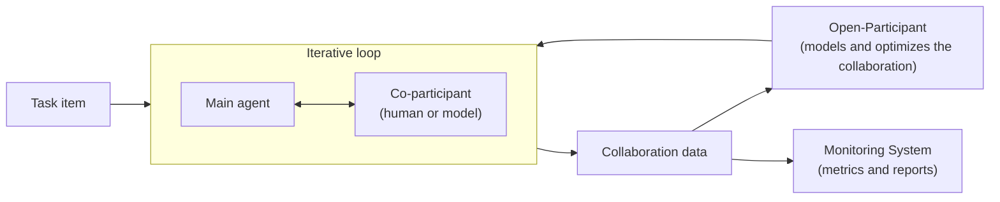

# Open-Loop

**An Agent Harness for Optimizing Scientific Collaboration**

**📄 Paper (coming soon)** &nbsp;·&nbsp;
**[🧩 Companion toolkit: Open-Complexity >>](https://github.com/ngotrnghia1811/open-complexity)** &nbsp;·&nbsp;
**[🌐 Author page >>](https://ngotrnghia1811.github.io)**

## 📖 Introduction

Scientific work is collaborative and iterative.
A researcher consults colleagues, revises a plan, and repeats an experiment before a result stands.
Current agent harnesses evaluate one model on one pass, and they give no explicit support to a second participant.
Without that support, a harness cannot configure, run, or measure the collaboration itself.
Previous work shows that agent rankings under human collaboration differ from the solo rankings of the same agents.
So a solo evaluation does not predict collaborative performance.

Open-Loop is an agent harness that places a second participant, human or model, beside the agent under test on any scientific benchmark.
Open-Loop generalizes the standard forward pass to an iterative experimental loop.
In this loop, the agent and its collaborator repeat and revise their work on one task.

The project makes three contributions:

1. **Open-Loop**, a harness that makes collaboration in the loop explicit, configurable, and measurable.
2. **Open-Participant**, a framework that models the second participant and optimizes the collaboration toward better alignment and efficiency.
3. **An evaluation** on a scientific benchmark, with ablations over the loop and the participant.

## 🚀 Quick Start

The code is not public yet.
The code, the API documentation, and a demonstration will be released together with the paper.
Watch this repository to get a notification at release time.

## 📦 What's Included

Open-Loop is a pipeline of three components.
The components follow the order of a standard training process: data processing, training, and evaluation.

### 🔁 Collaboration Data Processor

- **The iterative loop**
  - One forward pass of Open-Loop is one loop of several runs on one task item.
  - The two participants can repeat and revise their work across the runs.
  - Only the final answer gets a score.
- **The Co-participant**
  - A person can fill the Co-participant position through a web interface.
  - A model can fill the same position.
- **Collaboration data**
  - The processor records the ordered exchange of turns between the two participants.
  - Each turn carries its text and a small typed header.
    - The header names the function of the turn, for example a request or an answer.
    - The header also names the turn that it replies to.

### 🎯 Open-Participant

- **Modeling the Co-participant**
  - Open-Participant learns how the Co-participant acts from the recorded collaboration data.
- **Optimizing the collaboration**
  - Open-Participant compares the exchange of the pair with an expert exchange on the same task.
  - It optimizes the collaboration so that the exchange gets closer to the expert exchange.
  - It also tries to lower the number of turns needed to reach a correct answer.

### 📊 Monitoring System

- **Collaboration metrics**
  - The system measures the collaboration of each run, not only the final score.
- **Reports**
  - A web view shows the runs, the metrics, and the progress of the training.

### 🧭 Two Uses

- **Human-in-the-loop use**
  - A person collaborates with the main agent on a task through the web interface.
- **Optimization use**
  - Open-Loop optimizes the collaboration process itself from collaboration data.

## 🧪 Benchmarks

- [LABBench2](https://arxiv.org/abs/2604.09554): a benchmark of biology research tasks.

## 👍 Contributing

The code is not open for contributions yet.
Questions and feedback are welcome through the issues of this repository.

## 👀 See Also

- [Open-Complexity](https://github.com/ngotrnghia1811/open-complexity): a diagnostic toolkit that analyzes what makes a scientific task complex, synthesizes verifiable collaboration data, and scales task difficulty without new tasks.

## 👨‍🎓 Creators

Open-Loop is developed by [Nghia Trung Ngo](https://ngotrnghia1811.github.io).

## 🗞️ Citation

The paper is not public yet.
A BibTeX entry will be added here when the paper is available.

## 📝 License

All rights reserved until the release.
The code is planned for release under the MIT license, and the released transcripts under CC BY-SA 4.0.
