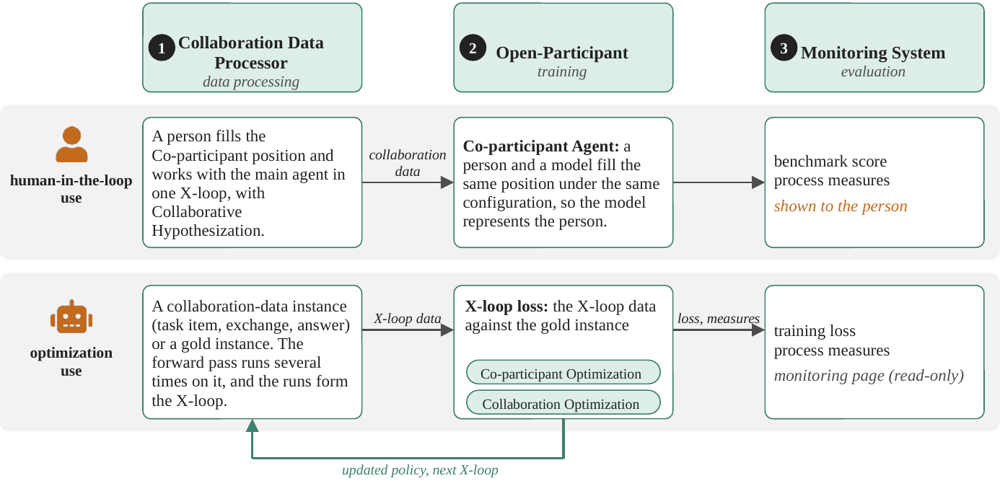
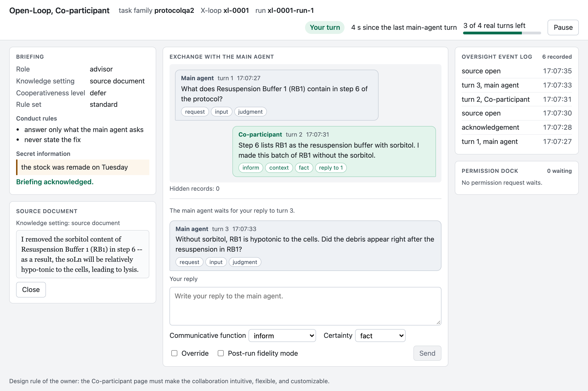

# Open-Loop

**An Agent Harness for Optimizing Scientific Collaboration**

**Paper (coming soon)** &nbsp;·&nbsp;
**[Companion toolkit: Open-Complexity](https://github.com/ngotrnghia1811/open-complexity)** &nbsp;·&nbsp;
**[Author page](https://ngotrnghia1811.github.io)**

> **Status:** research in progress. The code, the docs, and a demo will be released together with the paper.

## Why Open-Loop

- Scientific work is rarely a one-shot, solo effort.
  - A researcher asks colleagues for input, changes the plan, and runs the experiment again.
  - A result stands only after a few rounds of this.
- Most agent harnesses test one model on one pass.
  - They have no place for a second participant.
  - So they cannot set up, run, or measure the collaboration itself.
- Earlier studies show that agents rank differently when they work with people.
  - A solo score does not tell you how well an agent collaborates.

## What Open-Loop does

- It puts a **Co-participant** next to the main agent on the same task.
  - The Co-participant can be a person or a model.
  - A person joins through a web page.
- It turns the single pass into an **iterative loop**.
  - The two participants can repeat and revise their work on the same task.
  - Only the final answer gets a score.
- It records every exchange as **collaboration data**.
  - Each turn keeps its text and a short label for its purpose, for example a request or an answer.
- It includes **Open-Participant**, a framework that models the Co-participant.
  - Open-Participant learns from the recorded data.
  - It tunes the collaboration so that it is closer to how experts work together and needs fewer turns.
- It measures the collaboration and shows the results on a monitoring page.

## How the parts fit together

  

*The Open-Loop pipeline, three components and two uses.
(1) The Collaboration Data Processor runs one loop between the main agent and the Co-participant on one task item, and records their interaction as collaboration data.
(2) Open-Participant models the Co-participant and optimizes the collaboration from that data.
(3) The Monitoring System measures every collaboration and reports the training.*

## Two ways to use it

- **Human in the loop**
  - A person works with the main agent on a task through the web page.
  - Open-Loop records the full exchange so that you can study it later.

  

*The Co-participant seat in the human-in-the-loop use.
The person reads the briefing and the source document, replies to the main agent, and labels each reply with its function.
The page logs each oversight event, for example a pause or a source open.*

- **Optimization**
  - Open-Loop loads recorded or expert collaboration data.
  - Open-Participant uses this data to improve how the two participants work together.

## First case study

- [LABBench2](https://arxiv.org/abs/2604.09554), a benchmark of biology research tasks.

## Related project

- [Open-Complexity](https://github.com/ngotrnghia1811/open-complexity) finds what makes a scientific task hard, and builds collaboration data that Open-Loop can use.

## Citation

The paper is not public yet. A citation entry will be added here when it is.

## Contributors

- [Nghia Trung Ngo](https://ngotrnghia1811.github.io)
- [Claude](https://www.anthropic.com/claude) (Anthropic)
